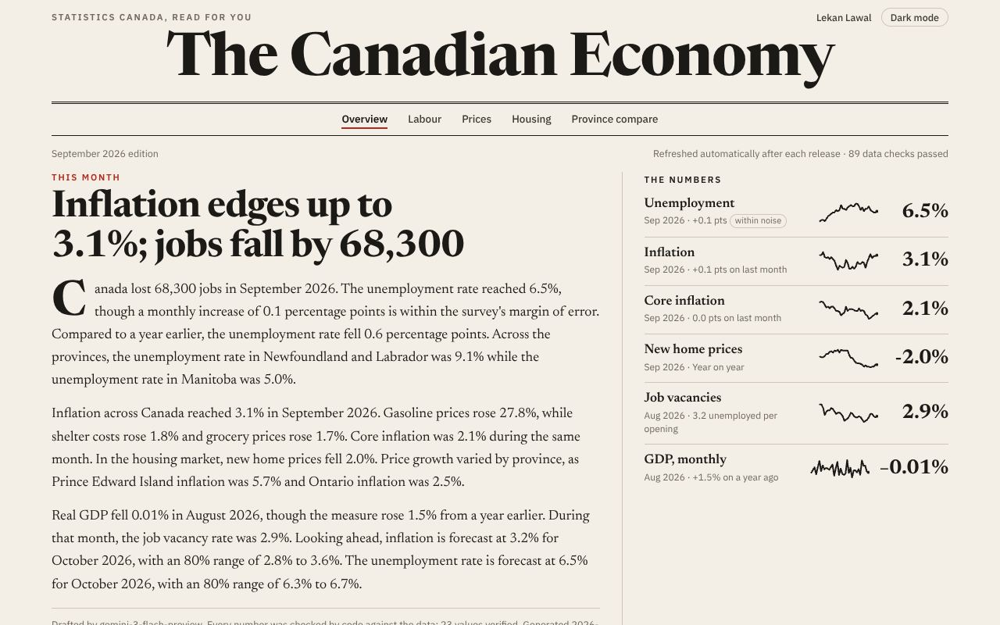

# Canada Economy Intelligence Platform

A dashboard of Canada's economy that keeps itself up to date. Every weekday it checks Statistics Canada for new data, and when there is some, it rebuilds everything and publishes the new version on its own.

[Open the dashboard](https://lekanlawal1.github.io/project5-canada-economy-platform/)



## Why I built it

Economic numbers get reported as headlines ("employment fell by 41,700!") with no sense of whether they mean anything. I wanted one place that shows the numbers, says which moves are real and which are noise, and stays current without me touching it. It also had to cost nothing to run.

## How it works

A GitHub Action checks StatCan each weekday. If anything changed, it downloads the tables (about 1.4 GB of CSV), builds a SQL warehouse in DuckDB, and runs 89 data checks. If any check fails, the build stops and the live site keeps its last good version. If they pass, it re-runs the forecasts, has Gemini draft a monthly briefing, and redeploys.

The briefing was the part I was most careful with. Code checks every number in Gemini's draft for the right value, the right measure and the right direction. If the draft fails twice, a plain template goes out instead, so a wrong number can't get published.

There's also a personal inflation calculator. You enter roughly what you spend each month, and it works out your own inflation rate instead of the national average, and tells you why it differs.

## What I found

- Most monthly job moves are noise. That 41,700 drop in August 2026 is inside StatCan's own margin of error, so the chart shows it in grey.
- For unemployment, no forecasting model I tried beat "next month equals this month", so that's what the site publishes. For inflation, a seasonal model did beat it, by 19%. I wrote the testing rules down before seeing any results, so I couldn't move the goalposts.
- The number checker caught all 15 errors I planted in test drafts, with no false alarms. In the first 10 live runs, though, only 5 AI drafts made it through. Most failures were the checker being too strict, not the AI being wrong. After fixing both sides, the next 20 runs all published.
- The headline figures match StatCan's official releases exactly, and every build re-checks that.

## Run it

```bash
pip install -r requirements.txt
python -m src.ingest && python -m src.build && python -m src.forecast
python -m src.data_tests && python -m src.site_export
python -m src.briefing            # uses GEMINI_API_KEY if set, a template otherwise
cd site && python -m http.server  # http://localhost:8000
```

## More

[docs/details.md](docs/details.md) has the full write-up, and each stage has its own doc: [ingest](docs/01_ingest.md), [SQL models](docs/02_models.md), [data tests](docs/03_data_tests.md), [forecasts](docs/04_forecasts.md), [briefing](docs/06_briefing.md) and [automation](docs/07_automation.md).

Data: Statistics Canada, under the Open Government Licence: Canada.
